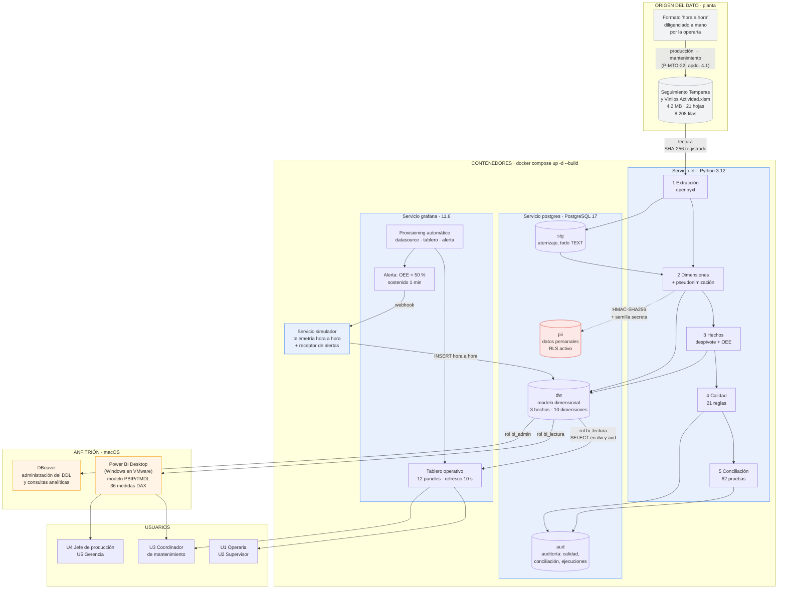

# Arquitectura de la solución

## 1. Diagrama



### Versión en texto

```
  PLANTA                      CONTENEDORES (Docker)                ANFITRIÓN
  ──────                      ─────────────────────                ─────────

  Formato papel
  "hora a hora"
       │
       │ producción → mantenimiento
       ▼
  ┌──────────┐    lee     ┌─────────────────────┐
  │  .xlsm   │ ─────────► │   ETL (Python)      │
  │ 8.208    │  SHA-256   │ 1 Extracción        │
  │ filas    │  registrado│ 2 Dimensiones       │
  └──────────┘            │ 3 Hechos            │
                          │ 4 Calidad (21)      │
                          │ 5 Conciliación (62) │
                          └──────────┬──────────┘
                                     │ COPY, transacción única
                                     ▼
                          ┌─────────────────────────────┐
                          │  PostgreSQL 17              │        ┌──────────┐
                          │  ┌───────┐  ┌────────────┐  │ bi_    │ DBeaver  │
                          │  │  stg  │─►│     dw     │◄─┼────────┤ (DDL +   │
                          │  └───────┘  └─────┬──────┘  │ admin  │ SQL)     │
                          │  ┌───────┐        │         │        └──────────┘
                          │  │  pii  │  RLS   │         │
                          │  └───────┘        │         │        ┌──────────┐
                          │  ┌───────┐        │         │ bi_    │ Power BI │
                          │  │  aud  │        │         │ lectura│ (Windows │
                          │  └───────┘        │         ├───────►│  VMware) │
                          └───────────────────┼─────────┘        └──────────┘
                                     ▲        │ bi_lectura
                 INSERT hora a hora  │        ▼
                          ┌──────────┴──┐  ┌──────────────────┐
                          │  SIMULADOR  │  │   GRAFANA 11.6   │
                          │  + receptor │◄─┤  provisioning    │
                          │  de alertas │  │  automático      │
                          └─────────────┘  │  12 paneles      │
                                  webhook  │  alerta OEE<50%  │
                                           └──────────────────┘
```

---

## 2. Las cuatro capas y por qué están separadas

### Capa 1 · Origen

El Excel **se lee, nunca se escribe**. El ETL registra su **SHA-256** en
`aud.ejecucion_etl`, de modo que si la fuente cambia queda constancia de que
las cifras se calcularon sobre otro archivo. La copia de trabajo vive en
`datos/fuente/`.

### Capa 2 · Almacén: cuatro esquemas con responsabilidades distintas

| Esquema | Contiene | Quién puede leerlo |
|---|---|---|
| `stg` | Zona de aterrizaje, **todo como `TEXT`** | Solo `bi_admin` |
| `dw` | El modelo dimensional | `bi_admin` y `bi_lectura` |
| `pii` | Nombres reales de operarios y personal, con **RLS** | Solo el rol `pii_reidentificacion` |
| `aud` | Calidad, conciliación y registro de ejecuciones | `bi_admin` y `bi_lectura` |

La separación no es organizativa, es **el mecanismo de seguridad**: los
tableros se conectan con `bi_lectura`, que tiene `SELECT` únicamente en `dw` y
`aud`. Está comprobado que ese rol **no puede** leer `pii` ni `stg`, ni escribir
en `dw` (ver [10-datos-personales-y-seguridad.md](10-datos-personales-y-seguridad.md)).

Que `aud` sea legible por los tableros es intencional: permite publicar el
indicador de completitud del registro junto a los indicadores de negocio, para
que quien lea un número sepa de qué calidad de dato viene.

### Capa 3 · Transformación

El ETL corre **una vez, al arrancar la pila**, y termina. No es un servicio:
`restart: "no"` y Grafana espera a que haya finalizado con éxito
(`service_completed_successfully`) para no mostrar nunca un tablero vacío.

### Capa 4 · Consumo

Dos capas con propósitos distintos, detallado en
[08-powerbi-vs-grafana.md](08-powerbi-vs-grafana.md):

- **Grafana** en el contenedor, conectado a `dw` para el tablero operativo.
- **Power BI** en el anfitrión (Windows sobre VMware), conectado a `dw` para el
  tablero analítico. **No lee el Excel**: lee la base de datos.
- **DBeaver** en el anfitrión, para administrar el DDL y ejecutar las consultas
  analíticas.

---

## 3. Decisiones de la contenerización

### 3.1. Un solo comando

```bash
docker compose up -d --build
```

Los scripts de DDL están montados en `/docker-entrypoint-initdb.d`, que la
imagen de PostgreSQL ejecuta en orden alfabético al crear el volumen de datos:
`00_roles_y_esquemas` → `10_ddl_staging` → `20_ddl_dimensiones` →
`30_ddl_hechos` → `40_indices_y_restricciones` → `50_vistas_analiticas` →
`60_permisos` → `70_diccionario`.

### 3.2. Orden de arranque garantizado con `healthcheck`

```yaml
postgres:
  healthcheck:
    test: ["CMD-SHELL", "pg_isready -U $POSTGRES_USER -d $POSTGRES_DB"]
etl:
  depends_on:
    postgres: { condition: service_healthy }
grafana:
  depends_on:
    etl: { condition: service_completed_successfully }
```

`depends_on` sin condición solo espera a que el contenedor **arranque**, no a
que el servicio esté **listo**: el ETL fallaría intentando conectarse a una
base que todavía está inicializándose. Con `service_healthy` espera a que
`pg_isready` responda, y con `service_completed_successfully` Grafana espera a
que el ETL **termine bien**.

### 3.3. Persistencia por volúmenes nombrados

```yaml
volumes:
  pgdata:      { name: bioee-pgdata }
  grafana-data:{ name: bioee-grafana-data }
```

Volúmenes **nombrados** y no *bind mounts* a carpetas del anfitrión, por dos
razones:

- El rendimiento de E/S de un bind mount en macOS es notablemente peor.
- Los datos de PostgreSQL son archivos internos del motor: no tienen por qué
  estar en el árbol del proyecto, y si estuvieran acabarían en el repositorio
  por descuido.

`docker compose down` conserva los datos; `down -v` los borra y fuerza una
reconstrucción completa, que es precisamente la prueba de reproducibilidad.

> **Nota de implementación, encontrada por las malas:** el proyecto vive en
> `~/Developer` y **no** en iCloud Drive, porque Docker en macOS no puede
> montar rutas de iCloud (falla con `Operation not permitted` al leer
> `/docker-entrypoint-initdb.d/`). Además, un repositorio git dentro de iCloud
> se corrompe por la sincronización.

### 3.4. Credenciales por variables de entorno

Ningún archivo del repositorio contiene una contraseña ni una cadena de
conexión con contraseña. `docker-compose.yml` referencia `${POSTGRES_PASSWORD}`
y similares; los valores viven en `.env`, que está **excluido** por
`.gitignore`. Se versiona `.env.example` con los nombres de las variables y
comentarios sobre qué poner en cada una.

Un bloque YAML reutilizable evita repetir la configuración en cada servicio:

```yaml
x-db-env: &db-env
  PGHOST: postgres
  PGDATABASE: ${POSTGRES_DB}
  PGUSER: ${POSTGRES_USER}
  PGPASSWORD: ${POSTGRES_PASSWORD}
```

### 3.5. Provisioning de Grafana: cero configuración manual

Es el requisito que distingue a quien entendió Docker, y se resuelve con tres
archivos montados en `/etc/grafana/provisioning`:

| Archivo | Qué carga |
|---|---|
| `datasources/postgres.yml` | La conexión a PostgreSQL con el rol `bi_lectura`; la contraseña se interpola desde la variable de entorno |
| `dashboards/tableros.yml` | El proveedor que lee los JSON del repositorio, con `allowUiUpdates: false` |
| `alerting/alertas.yml` | La regla de alerta, el punto de contacto y la política de notificación |

`allowUiUpdates: false` es deliberado: **el tablero del repositorio es la única
verdad**. Nadie puede editarlo desde la interfaz y dejar el repositorio
desactualizado; para cambiarlo hay que editar el JSON y versionarlo, que es el
objetivo del control de versiones.

### 3.6. Qué corre en el contenedor y qué en el anfitrión

| Componente | Dónde | Por qué |
|---|---|---|
| PostgreSQL, ETL, Grafana, simulador | Contenedor | Son los componentes de servidor; se reproducen con un comando |
| Power BI Desktop | Anfitrión (Windows/VMware) | Es una aplicación de escritorio solo para Windows |
| DBeaver | Anfitrión | Es un cliente de escritorio |

PostgreSQL publica el puerto **55432** del anfitrión (no el 5432, para no
chocar con una instalación local), y así Power BI y DBeaver se conectan desde
fuera del contenedor.

---

## 4. Flujo de una cifra, de principio a fin

Para fijar la arquitectura, el recorrido de un dato concreto:

1. **07:00.** La operaria de Vinilos_2 anota en el formato de papel: 42 pacas,
   referencia Parchesitos 125 cc, paro de 12 min por código 05 con subcódigo
   5.2.
2. **Al final del turno**, producción remite el formato a mantenimiento.
3. **Mantenimiento digita** la fila en la hoja `Registro` y pulsa «Ingreso
   total»; la macro la escribe en `Base De Datos`, fila 4.317.
4. **`docker compose up`.** El ETL lee la fila 4.317, la carga en
   `stg.base_datos` como texto y registra el SHA-256 del archivo.
5. **Fase de dimensiones.** «Parchesitos 125 cc» resuelve a
   `referencia_key = 31`; el estándar vigente de (Vinilos_2, 31) da una tasa
   ideal de 48 unidades/min; el subcódigo `5.2` resuelve al sistema
   `SYS-DOSIF`, «Sistema de dosificación de pintura».
6. **Fase de hechos.** Se crea una fila en `hecho_produccion_turno` con
   `horas_programadas = 8`, `horas_paro_total = 0,2`,
   `unidades_producidas = 42 × 24 = 1.008` y una `Disponibilidad` de 0,975. Y
   una fila en `hecho_paro` con `minutos_paro = 12`, apuntando al sistema
   dosificador.
7. **Fase de calidad.** La fila pasa las 21 reglas sin banderas.
8. **Fase de conciliación.** Sus 8 horas y sus 42 pacas entran en los totales
   que se contrastan contra las tablas dinámicas del Excel.
9. **Grafana** la muestra en el Pareto del turno; **Power BI** la suma al OEE
   del mes y la compara contra el mismo mes del año anterior.
10. **El coordinador de mantenimiento** ve que el sistema dosificador acumula
    el 44,6 % del tiempo perdido con causa raíz identificable y lo lleva al
    comité con una cifra, no con una
    impresión.
